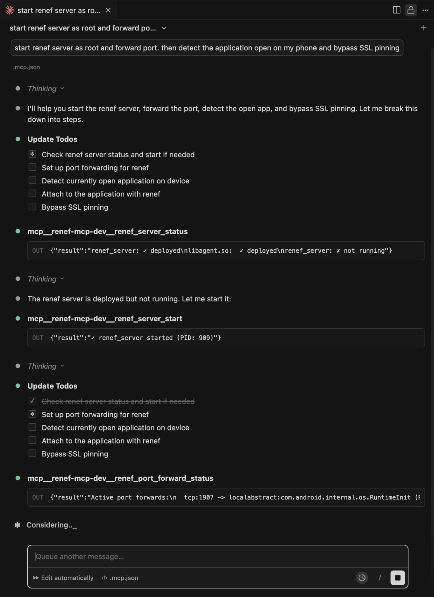

# Renef MCP Server (v0.4.0)


MCP server for **[Renef](https://github.com/Byterialab/renef) v0.4.0** — Dynamic instrumentation toolkit for Android ARM64 reverse engineering and security analysis.

Powered by Renef v0.4.0's **pure-Python framed TCP client** (talks directly to `renef_server` over `127.0.0.1:1907` — no CLI subprocess, no prompt scraping, works on macOS, Linux, and Windows). Compatible with both `mcp` SDK v1.x (`FastMCP`) and v2.x (`MCPServer`).

## Features

- **Core & Framed Protocol**: `renef_spawn` (signal-based or `--pause`/`--hold` spawn gate), `renef_attach` (PID or package name), `renef_resume`, `renef_exec` (arbitrary multiline Lua), `renef_rpc` (JSON expression evaluation), `renef_events` (dedicated v0.4.0 `@events` channel for hook output & `send()` JSON events), `renef_verbose`, `renef_reset`
- **Hooking & Native Calling**: Inline trampoline & PLT/GOT (`caller=`) native hooks, deferred hooks, async hooks, `Interceptor.replace`/`revert`, `NativeFunction` (int/ptr/bool/string/float/double), Android 12+ safe Java/ART hooks (`args.skip`, `onLeave` String/primitive override, individual `unhook j0`), `hookgen`
- **Memory & Passive Memdump**: Safe maps-checked `renef_mem_read` (`hex`/`hexdump`/`string`/`u8..u64`/`pointer`), `renef_mem_write` (auto-patch), `renef_mem_search` (strings & hex wildcards), `renef_mem_manage` (`alloc`/`allocStr`/`free`/`protect`), `renef_mem_dump`, and injection-free / ptrace-free `renef_memdump_passive` (`/proc/<pid>/maps` & `/proc/<pid>/mem`)
- **Modules, Disassembly & Process**: `renef_module_list`, `renef_module_find`, `renef_module_exports` (glob wildcards via `Module.findExportByName` + `.symtab`), `renef_module_sections`, Capstone ARM64 `renef_disassemble`, `renef_detect_framework`, `renef_process` (`ranges`, `threads`, `thread_id`, PAC-aware `backtrace`)
- **Java & JNI**: `renef_java_classes` (`Java.enumerateLoadedClasses`), `renef_java_call` (`Java.use` static/constructor/instance calls), `renef_java_method_info` (`Java.methodInfo`), `renef_jni` (`Jni.*` raw helpers)
- **System Instrumentation**: `renef_syscall` (`Syscall.trace`/category/`traceAll`/`untrace`/`stop`/`list`/`active`), `renef_file` (`read`/`write`/`exists`/`readlink`/`fdpath`), `renef_os` (`getpid`/`listdir`/`kill`/`tgkill`), `renef_kcov` (Linux KCOV kernel coverage)
- **Server & ADB Management**: `renef_server` (deploys v0.4.0 `renef_server` + `/data/local/tmp/libagent.so` with SELinux `chcon`, start/kill/restart/status/logs), `renef_port_forward` (including gadget mode), `adb_devices`, `adb_device_status`, `adb_app`
- **Recipes, API Reference & SSL Pinning Knowledge Base**: `renef_recipes` + MCP resources (`renef://api-reference`, `renef://recipes`, `renef://recipes/{name}`, `techniques://ssl_pinning/{platform}`) + `renef_lua_guide` prompt

## Screenshots


## Installation

```bash
pip install renef-mcp
```

### Configuration

Add to your MCP client configuration:

```json
{
  "mcpServers": {
    "renef": {
      "command": "renef-mcp"
    }
  }
}
```

Optional environment variables:
- `RENEF_HOST` — `renef_server` TCP host (default: `127.0.0.1`)
- `RENEF_PORT` — `renef_server` TCP port (default: `1907`)
- `RENEF_DEVICE_ID` — target ADB device serial when multiple devices are connected

## Development & Tests

```bash
pip install -e ".[dev]"
pytest -v
```

## Documentation

- Homepage: https://renef.io
- Renef tool: https://github.com/Byterialab/renef
- Repository: https://github.com/Ahmeth4n/renef-mcp
- Issues: https://github.com/Ahmeth4n/renef-mcp/issues

## License

MIT License - Copyright (c) 2025-2026 Byteria
